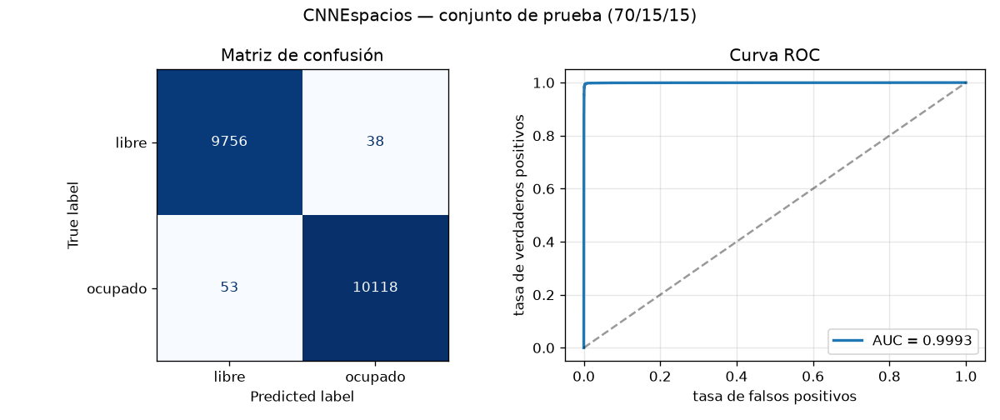
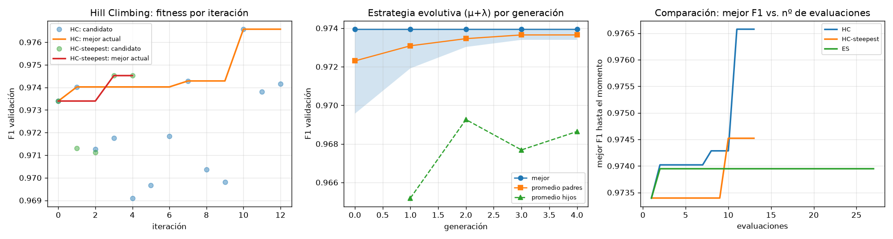
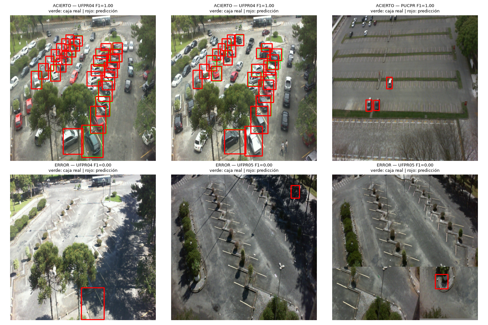
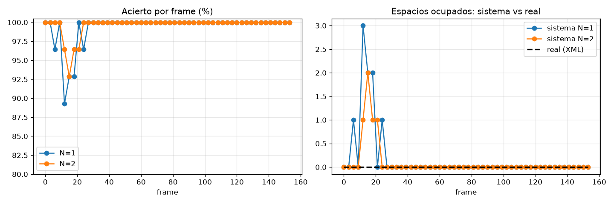
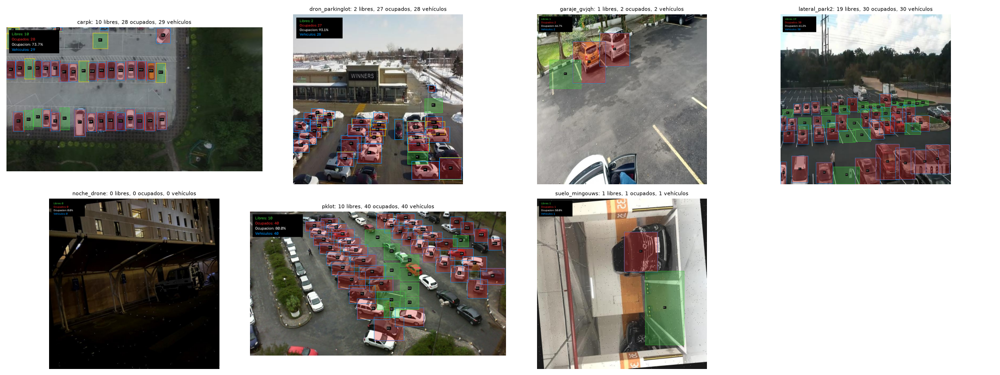

# 🅿️ Detección inteligente de ocupación de parqueaderos

Proyecto final de **Sistemas de Inteligencia Artificial** — *Proyecto 7: Detección de ocupación de parqueaderos*.

El sistema analiza **imágenes y videos** de un parqueadero, decide para cada espacio si está **libre u ocupado**,
calcula el **% de ocupación**, dibuja los espacios (verde = libre, rojo = ocupado) y tiene un **asistente
conversacional basado en un Transformer** que responde en español con los datos reales del análisis y da
retroalimentación sobre la confianza del resultado.

Tiene **dos modos**:

| Modo | Cómo funciona | Cuándo usarlo |
|---|---|---|
| **Automático (sin JSON)** | El **Modelo 4 (`DetectorUniversal`)** encuentra solo, en la imagen completa, los **espacios libres**, los **espacios ocupados** y los **vehículos**. | Cualquier imagen o video: dron (vista cenital), cámara en un edificio, cámara lateral, a nivel de suelo. No requiere calibrar nada. |
| **Calibrado (JSON de espacios)** | Se marcan una vez los espacios de una cámara fija; la **CNN** (Modelo 1) clasifica cada espacio y el **MiniDetector** (Modelo 2) desempata. | Una cámara fija instalada: es el modo más preciso para esa cámara. |

> **Restricción del curso:** los cuatro modelos (CNN, MiniDetector, Transformer y DetectorUniversal) se diseñaron capa por capa y se
> **entrenaron desde cero con pesos aleatorios**. No se usa ningún modelo ni peso preentrenado, ni librerías
> de detección ya hechas. Solo bloques básicos de PyTorch (`nn.Conv2d`, `nn.Linear`, `nn.LayerNorm`,
> optimizadores…). La atención multi-cabeza, la pérdida del detector, el NMS y el mAP están escritos a mano.
> Un test (`tests/test_restricciones.py`) revisa automáticamente que el código no use librerías ni pesos prohibidos.

---

## 1. Problema

Encontrar parqueadero cuesta tiempo y combustible. Con una cámara fija se puede saber en tiempo real qué espacios
están libres. Las dificultades: cambios de iluminación (sol, nubes, lluvia, noche), sombras, oclusiones entre
vehículos, perspectiva de la cámara y vehículos mal estacionados.

## 2. Flujo del sistema

```
 imagen / video (frame)
        │
        ▼
 ┌──────────────────────┐    config/espacios_<cámara>.json  (polígono de cada espacio, se marca 1 vez)
 │ Recorte de espacios  │◄── herramientas/marcar_espacios.py  ó  herramientas/pklot_a_json.py
 │ (perspectiva → 64×64)│
 └──────────┬───────────┘
            ▼
 ┌──────────────────────┐         ┌──────────────────────────────┐
 │ Modelo 1: CNNEspacios│         │ Modelo 2: MiniDetector (opc.) │  imagen completa 416×416
 │ P(ocupado) en LOTE   │         │ cajas de vehículos + NMS propio│
 └──────────┬───────────┘         └──────────────┬───────────────┘
            └──────────────┬─────────────────────┘
                           ▼
                ┌────────────────────┐
                │ Regla de fusión     │  CNN segura → decide la CNN; CNN duda → IoU con cajas
                └─────────┬──────────┘
                          ▼  (video: suavizado temporal de N frames, 1 de cada K frames)
                ┌────────────────────┐
                │ estado (JSON)       │  libres, ocupados, %, confianza, dudosos, discrepancias
                └───┬────────────┬───┘
                    ▼            ▼
      visualización (verde/rojo,  Modelo 3: TransformerAsistente
      panel, gráfica temporal)    pregunta → intención → plantilla llenada con el estado
```

**Modo automático:**

```
 imagen / frame ──► Modelo 4: DetectorUniversal (centros + tamaño, 3 clases) ──► resolución automática
                    (800 px; si los objetos salen diminutos, + 1280 px)
        ──► NMS por clase + NMS cruzado libre/ocupado ──► consistencia espacio-vehículo
        ──► regla de FILAS (carros alineados sin espacio → ocupado; huecos en la fila → libre inferido)
        ──► (video: seguidor por IoU + suavizado de N frames) ──► estado (mismo formato) ──► app + asistente
```

## 3. Arquitecturas (todas desde cero)

### Modelo 1 — `CNNEspacios` (`modelos/cnn_espacios.py`) · **548 482 parámetros**

| Capa | Salida |
|---|---|
| Entrada RGB 64×64 | 3×64×64 |
| Conv 3×3 (3→16) + BatchNorm + ReLU + MaxPool 2 | 16×32×32 |
| Conv 3×3 (16→32) + BatchNorm + ReLU + MaxPool 2 | 32×16×16 |
| Conv 3×3 (32→64) + BatchNorm + ReLU + MaxPool 2 | 64×8×8 |
| Flatten → Linear(4096→128) + ReLU + Dropout | 128 |
| Linear(128→2) → softmax | P(libre), P(ocupado) |

Configurable desde `config/config.yaml` (filtros, neuronas, dropout). Pérdida `CrossEntropyLoss`, scheduler
`ReduceLROnPlateau`, early stopping y aumento de datos **en GPU**: brillo/contraste, flip horizontal, rotación
±10° y desenfoque gaussiano (simula lluvia/sombra). La salida es la clase y su probabilidad (confianza).

### Modelo 2 — `MiniDetector` (`modelos/mini_detector.py`) · **2 891 162 parámetros**

Detector propio de una etapa basado en una **cuadrícula 13×13**:

* Backbone: 5 bloques Conv+BatchNorm+LeakyReLU+MaxPool (416→13) y 3 convoluciones extra (512-256-512).
* Cabeza: Conv 1×1 que produce por celda y por cada una de las **B = 2** cajas `[objetividad, x, y, w, h]`.
  `x, y` es la posición del centro dentro de la celda; `w, h` se predicen como raíz cuadrada del tamaño relativo.
* **Pérdida a mano:** `L = λ_coord·MSE(coords) + BCE(obj | hay objeto) + λ_noobj·BCE(obj | no hay objeto)`,
  con λ_coord = 5 y λ_noobj = 0.5.
* **Postproceso a mano:** umbral de confianza + **NMS propio** (`inferencia/nms.py`).
* **Métricas a mano:** precisión, recall y **mAP@0.5** (`evaluacion/metricas_detector.py`, AP con interpolación
  de todos los puntos).

### Modelo 3 — `TransformerAsistente` (`modelos/transformer_asistente.py`) · **246 537 parámetros**

* **Tokenizador propio** de subpalabras (`asistente/tokenizador.py`): minúsculas, sin tildes, vocabulario de
  palabras frecuentes + piezas de 2–4 letras construidas solo con el conjunto de entrenamiento (2 797 tokens) y
  partición "coincidencia más larga primero". Así una palabra con error de tipeo se parte en piezas conocidas.
* Embedding (d = 64) + **codificación posicional sinusoidal** + **2 capas encoder**, cada una con
  **multi-head self-attention escrita a mano** (4 cabezas, `softmax(QKᵀ/√d_k)·V`, máscara de relleno),
  feed-forward (128), conexiones residuales y LayerNorm → token **[CLS]** → Linear → 9 intenciones.
* Intenciones: `disponibilidad`, `porcentaje`, `ubicacion`, `conteo_ocupados`, `confianza`, `resumen`,
  `saludo`, `despedida`, `fuera_de_tema`.
* **Respuesta:** la intención elige una plantilla (`asistente/respuestas.py`) que se llena con el estado real:
  > "Sí, hay 27 de 40 espacios libres (32 % de ocupación). Libres: A3, A4, A5 …"
  > "La confianza promedio de la detección es 0.93; los espacios C4 y C5 tienen baja confianza (posible sombra,
  > oclusión…), conviene verificarlos. Atención: la CNN y el detector NO coinciden en 1 espacio (B7)."
* Si la confianza de la intención es < 0.5, o si ninguna palabra de la frase está en el vocabulario, el asistente
  dice que no entendió y sugiere preguntas válidas.

### Modelo 4 — `DetectorUniversal` (`modelos/detector_universal.py`) · **4 477 731 parámetros**

Detector de **centros de objetos** ("objetos como puntos") con 3 clases: **espacio libre, espacio ocupado,
vehículo**. Es el modelo del modo automático.

* **Backbone residual propio** (s2→s32): etapas Conv(paso 2)+BatchNorm+LeakyReLU con 0-1-2-2-2 bloques
  residuales y canales 24-48-96-160-256.
* **Cuello tipo pirámide:** se vuelve a subir la resolución (s32→s16→s8→s4) sumando los mapas del backbone por
  conexiones laterales 1×1. La salida queda a **1/4 de la imagen** (512 → 128×128), suficiente para carros
  diminutos vistos desde un dron alto.
* **Tres cabezas:** mapa de calor de centros por clase (3), log-tamaño de la caja por clase (6) y desfase
  sub-píxel del centro (2).
* **Pérdida a mano:** *focal loss* con reducción de penalización alrededor de cada centro (gaussiana de radio
  según el tamaño de la caja) + L1 en log-tamaño y desfase. Cuando una fuente de datos **no etiqueta** una
  clase (CARPK no marca espacios), esa clase se **ignora** en sus imágenes, para no castigar al modelo.
* **Decodificación:** máximos locales del mapa de calor (max-pool 3×3), sin cajas ancla; luego NMS propio.
  Es totalmente convolucional: acepta cualquier tamaño de imagen múltiplo de 32.
* **Postproceso propio** (`inferencia/automatico.py`, `inferencia/filas.py`): NMS por clase, NMS cruzado
  libre/ocupado, "un espacio libre que contiene un vehículo detectado pasa a ocupado", **regla de filas** y
  resolución automática (ver §5.7).

### ¿Por qué entrenar desde cero?

Es la restricción del curso, y además el problema lo permite: un recorte de 64×64 de un espacio es una tarea
visual sencilla y hay cientos de miles de ejemplos etiquetados, de modo que una CNN pequeña (0.5 M parámetros)
alcanza >99 % sin transferencia de aprendizaje. Entrenar desde cero también obliga a entender cada pieza
(inicialización, normalización, pérdida, optimizador), que es lo que se evalúa.

## 4. Datos y preprocesamiento

| Dataset | Qué trae | Uso |
|---|---|---|
| **CNRPark-EXT** | 144 965 recortes 150×150 de espacios (9 cámaras, soleado/nublado/lluvioso) con etiqueta libre/ocupado | Modelo 1 |
| **PKLot** | 12 416 imágenes completas de 3 parqueaderos (UFPR04, UFPR05, PUCPR) × 3 climas, con XML (contorno + estado de cada espacio) | Modelos 1 y 2, JSON de espacios, video |

* **Modelo 1:** 60 000 recortes de CNRPark-EXT (muestreo estratificado por clima y clase) + 73 100 recortes de
  PKLot obtenidos de 1 350 imágenes (150 por parqueadero y clima). Los recortes de PKLot **no** se toman de
  `PKLotSegmented`: se generan con la **misma transformación de perspectiva** que usa el pipeline en producción
  (`inferencia/recorte.py`), para que entrenamiento e inferencia vean el mismo tipo de imagen.
  Total **133 099 recortes** (51 % ocupados), división **70/15/15 estratificada** por fuente, parqueadero,
  clima y clase (93 169 / 19 965 / 19 965).
* **Modelo 2:** PKLot no trae cajas de vehículos, pero sí el contorno de cada espacio y si está ocupado. Como
  etiqueta aproximada se usa el **rectángulo envolvente** (`cv2.boundingRect`) del contorno de cada espacio
  **ocupado**, convertido a `[clase, x_centro, y_centro, ancho, alto]` normalizado. 2 821 imágenes (≈ 330 por
  parqueadero y clima) redimensionadas a 416×416, con 78 171 cajas; división 70/15/15 estratificada.
  *Consecuencia:* el detector aprende "vehículo dentro de un espacio"; no detecta carros en vías ni fuera de los
  espacios anotados, y las cajas son más grandes o pequeñas que el carro real según la perspectiva.
* **Modelo 3:** dataset sintético (`asistente/generar_dataset.py`): 600 frases por intención (5 400 en total)
  con plantillas, sinónimos, prefijos/sufijos coloquiales colombianos ("parce", "¿hay cupo?", "¿está full?"),
  errores de tipeo (borrar, duplicar, intercambiar o cambiar por tecla vecina), frases sin tildes, sin signos y en
  mayúsculas, y preguntas fuera de tema generadas por combinación + texto sin sentido. División 70/15/15.
* **Modelo 4:** 7 fuentes unificadas en un solo formato de cajas con 3 clases
  (`scripts/descargar_roboflow.py` + `scripts/preparar_detector_universal.py`). De Roboflow Universe se
  descargan **solo imágenes y anotaciones** (licencia CC BY 4.0), nunca modelos ni pesos:

  | Fuente | Vista | Clases etiquetadas | Imágenes train / val / test |
  |---|---|---|---|
  | PKLot (1 080 imágenes, partición por día) | cámara en edificio | libre, ocupado, vehículo* | 708 / 162 / 210 |
  | CARPK (Hsieh et al., ICCV 2017; copia de Roboflow) | dron, cenital | vehículo (106 613 cajas) | 1 098 / 314 / 155 |
  | `drone-software-meetup/parkinglot` | dron, cenital | libre, ocupado, vehículo* | 37 / 11 / 7 |
  | `my-project-ppguz/park-2` | cámara lateral en poste | libre, ocupado, vehículo* | 246 / 16 / 15 |
  | `mingouws/parking-space-detection` | cámara cercana / nivel de suelo | libre, ocupado, vehículo* | 1 973 / 421 / 425 |
  | `parking-gvjqh/parking-lot` | garaje y cámaras laterales | libre, ocupado, vehículo* | 305 / 68 / 68 |
  | `drone-wrcaq/parking-space` | nivel de suelo, de noche | libre, ocupado, vehículo* | 60 / 12 / 15 |

  \* la caja del vehículo se aproxima con la del espacio ocupado.
  Problemas de datos encontrados y cómo se resolvieron: (1) el CARPK original viene en un zip con contraseña que
  se pide a los autores, por eso se usó la copia de Roboflow, que viene **estirada** a 416×416: se le devolvió la
  proporción 16:9; (2) **404 de 459** imágenes del dataset de dron traen los objetos tapados con rectángulos
  negros (anonimización): se detectan contando bloques 16×16 completamente oscuros y se descartan, quedan 55;
  (3) en las fuentes sin partición de prueba se re-particiona **por imagen original** (las copias aumentadas
  de Roboflow van juntas) y, en el video de dron, por **bloques de 10 frames**, para evitar fugas.
  Aumento de datos: escala aleatoria 0.5×–1.6× (simula distintas alturas), recorte 512×512, volteos, rotación
  de 90° y volteo vertical en las fuentes cenitales, brillo/contraste/saturación, tono, gris y desenfoque.
  Muestreo ponderado por fuente para que PKLot, la más grande, no domine.
* **Día reservado:** un día completo de UFPR04 (`2012-12-23`, 156 fotos) **no se usa para entrenar**; con él se
  construye el video de demostración (`ejemplos/video_UFPR04.mp4`, time-lapse a 2 fps) y sus anotaciones.

## 5. Resultados

Todas las cifras salen de los scripts de `evaluacion/` y quedan en `resultados/` (CSV + PNG). GPU usada: NVIDIA
GTX 1050 (3 GB).

### 5.1 Modelo 1 — gradiente descendente: SGD con momentum vs. Adam (20 épocas, 93 169 recortes)

| Optimizador | lr | F1 validación | Accuracy test | Precisión test | Recall test | **F1 test** | Tiempo |
|---|---|---|---|---|---|---|---|
| SGD (momentum 0.9, Nesterov) | 0.01 | 0.9945 | 0.9936 | 0.9965 | 0.9909 | **0.9937** | 25 min |
| Adam | 0.001 | 0.9954 | 0.9943 | 0.9975 | 0.9913 | **0.9944** | 20 min |
| **Adam + config de Hill Climbing** (lr 8.46e-4, dropout 0.30, lote 128) — *modelo final* | 8.46e-4 | 0.9956 | **0.9954** | 0.9963 | 0.9948 | **0.9955** | 12 min |

Meta del enunciado (F1 ≥ 0.95 en prueba): **cumplida**. Curvas: `resultados/curvas_cnn_general.png`.

**Desglose del modelo de producción en el conjunto de prueba** (`resultados/metricas_cnn.csv`):

| Subconjunto de prueba | n | Accuracy | F1 |
|---|---|---|---|
| **Todo el test** (AUC = 0.9993; 38 FP, 53 FN) | 19 965 | 0.9954 | **0.9955** |
| CNRPark-EXT | 9 000 | 0.9917 | 0.9924 |
| PKLot | 10 965 | 0.9985 | 0.9985 |
| Soleado / nublado / lluvioso | 7 342 / 6 526 / 6 097 | 0.9935 / 0.9972 / 0.9959 | 0.9940 / 0.9968 / 0.9963 |
| PUCPR / UFPR04 / UFPR05 | 6 394 / 1 885 / 2 686 | 0.9987 / 0.9989 / 0.9978 | 0.9986 / 0.9986 / 0.9981 |



**Generalización** (se entrena un modelo nuevo SIN ver el dominio de prueba):

| Experimento | Entrena con | Prueba con | n prueba | Accuracy | Precisión | Recall | **F1** | AUC |
|---|---|---|---|---|---|---|---|---|
| Por parqueadero | PKLot UFPR04 + UFPR05 | **PUCPR completo** (nunca visto) | 42 625 | 0.9895 | 0.9810 | 0.9962 | **0.9886** | 0.9990 |
| Por clima | todo lo **soleado** (PKLot + CNR) | todo lo **lluvioso** | 40 646 | 0.9878 | 0.9968 | 0.9813 | **0.9890** | 0.9985 |

Comparado con el modelo general en esos mismos dominios (F1 0.9986 en PUCPR y 0.9963 en lluvia, cuando sí los vio
en entrenamiento), la caída es de ~1 punto: la CNN generaliza bien, pero no es perfecta. En PUCPR (cámara alta,
espacios pequeños) aumentan los **falsos positivos** (373: marca ocupados espacios libres); con lluvia aumentan los
**falsos negativos** (423: carros mojados/reflejos que parecen pavimento). Gráficas:
`cnn_generalizacion_parqueadero_cm_roc.png` y `cnn_generalizacion_clima_cm_roc.png`.

### 5.2 Optimización de hiperparámetros (Hill Climbing y estrategia evolutiva)

Espacio de búsqueda (vector normalizado en [0,1]⁴): learning rate (1e-4…1e-2, log), dropout (0.1…0.7), filtros
base {8,12,16,24,32} (bloques b, 2b, 4b) y tamaño de lote {32,64,128,256}. Fitness = F1 de validación tras
**3 épocas** sobre un subconjunto (12 000 train / 4 000 val) — el mismo evaluador para todos los métodos.

| Método | Evaluaciones | Mejor F1 val | lr | dropout | filtros | lote |
|---|---|---|---|---|---|---|
| Hill Climbing (tweak gaussiano, acepta si mejora) | 13 | **0.9766** | 8.46e-4 | 0.298 | 16-32-64 | 128 |
| HC máxima pendiente (3 vecinos por paso) | 13 | 0.9745 | 1.37e-3 | 0.44 | 16-32-64 | 128 |
| Estrategia evolutiva (μ+λ) = (3+6), 4 generaciones | 27 | 0.9739 | 5.32e-4 | 0.456 | 16-32-64 | 128 |



Lectura honesta: las diferencias entre configuraciones son pequeñas (≈ 0.3 puntos de F1, del mismo orden que el
ruido de entrenar 3 épocas), porque el problema es "fácil" para la CNN. Todos los métodos coincidieron en
filtros 16-32-64 y lote 128; lo que cambió fue el lr y el dropout. La estrategia evolutiva no mejoró a su mejor
individuo inicial: con σ = 0.3 los hijos caen lejos de los padres (el promedio de los hijos fue siempre menor), y
con solo 4 generaciones no alcanzó a refinar. Hill Climbing ganó con menos evaluaciones. La mejor configuración
(Hill Climbing) se usó para el entrenamiento final del Modelo 1 (`--usar-mejor-config`).

### 5.3 Modelo 2 — MiniDetector

40 épocas (≈ 100 min en la GTX 1050), Adam + OneCycle, precisión mixta. Selección del modelo por mAP@0.5 de
validación. 5.8 % de las cajas de entrenamiento no caben en su celda (más de B = 2 centros en la misma celda de
32×32 px) y se descartan.

| Conjunto de prueba | Imágenes | **mAP@0.5** | Precisión | Recall | F1 |
|---|---|---|---|---|---|
| **Todo el test** | 424 | **0.922** | 0.977 | 0.926 | 0.951 |
| UFPR04 | 143 | 0.989 | 0.986 | 0.990 | 0.988 |
| UFPR05 | 133 | 0.997 | 0.992 | 0.996 | 0.994 |
| PUCPR | 148 | 0.874 | 0.968 | 0.881 | 0.923 |

(umbral de confianza 0.4, NMS 0.45). PUCPR es el caso difícil: cámara alta, vehículos de ~15 px en la imagen de
416×416 y varios centros por celda; ahí baja el recall. Errores típicos (`resultados/detector_ejemplos.png`):
falsos positivos en sombras fuertes de árboles y en imágenes corruptas de PKLot. Recuerda que las "cajas reales"
son aproximadas (rectángulo del espacio), así que estas métricas miden "detectar un vehículo en un espacio".



**Efecto de la fusión en el video** (mismo video y anotaciones de la sección 5.5):

| Configuración | Acierto (N = 1) | Acierto (N = 2) | Error medio de conteo (N = 2) |
|---|---|---|---|
| Solo CNN | 99.38 % | 99.66 % | 0.10 |
| **CNN + MiniDetector (fusión)** | 99.66 % | **99.86 %** | 0.04 |

### 5.4 Modelo 3 — TransformerAsistente

| Conjunto | n | Accuracy |
|---|---|---|
| Test sintético (frases no vistas) | 810 | **0.947** |
| 40 preguntas escritas a mano (vocabulario y estilo distintos a las plantillas) | 40 | **0.850** |

Meta del enunciado (accuracy ≥ 0.90): **cumplida en el test sintético**. Las 40 preguntas manuales son más
difíciles (palabras nunca vistas como "campito", "moto", "encima"); ahí el modelo baja a 0.85, lo que muestra el
límite de un dataset sintético. Matrices de confusión: `resultados/asistente_matrices_confusion.png`.

### 5.5 Sistema completo en video

Video de demostración: día reservado de UFPR04 (156 fotos, 28 espacios), **no usado en entrenamiento**.
Se compara el estado de cada espacio contra las anotaciones de referencia (`evaluacion/anotaciones_manuales.json`,
52 frames, tomadas de los XML de PKLot que los autores del dataset etiquetaron a mano):

| Suavizado temporal | Acierto promedio por frame | Peor frame | Error medio en el conteo de ocupados |
|---|---|---|---|
| Sin suavizado (N = 1) | 99.38 % | 89.3 % | 0.17 espacios |
| **N = 2 frames** (configuración por defecto) | **99.66 %** | 92.9 % | 0.10 espacios |



### 5.7 Modelo 4 — DetectorUniversal (modo automático)

Entrenamiento desde cero: 30 épocas × 4 000 muestras, AdamW + OneCycle (lr máx. 2e-3), lote 8, AMP; **≈ 72 min**
en la GTX 1050. Mejor mAP@0.5 medio en validación: **0.800** (época 29).

**Conjunto de prueba** (imágenes nunca vistas; AP@0.5 por fuente y clase; P/R/F1 al umbral de operación 0.30):

| Fuente | Clase | Imágenes | Objetos | **AP@0.5** | Precisión | Recall | F1 |
|---|---|---|---|---|---|---|---|
| CARPK (dron) | vehículo | 155 | 10 423 | **0.968** | 0.965 | 0.891 | 0.927 |
| PKLot (edificio) | libre / ocupado / vehículo | 210 | 6 181 / 6 725 / 6 725 | **0.965 / 0.942 / 0.942** | 0.89 / 0.85 / 0.83 | 0.996 | 0.94 / 0.92 / 0.90 |
| Lateral (poste) | libre / ocupado / vehículo | 15 | 277 / 428 / 428 | **0.998 / 0.999 / 0.999** | 1.00 / 0.95 / 0.94 | 0.99 | 0.99 / 0.97 / 0.97 |
| Garaje | libre / ocupado / vehículo | 68 | 348 / 204 / 204 | **0.876 / 0.915 / 0.918** | 0.81 / 0.78 / 0.79 | 0.83–0.89 | 0.82 / 0.83 / 0.84 |
| Dron con espacios | libre / ocupado / vehículo | 7 | 104 / 176 / 176 | **0.818 / 0.705 / 0.691** | 0.96 / 0.91 / 0.90 | 0.71 / 0.54 / 0.53 | 0.82 / 0.68 / 0.67 |
| Nivel de suelo | libre / ocupado / vehículo | 425 | 1 344 / 1 044 / 1 044 | **0.667 / 0.748 / 0.722** | 0.74 / 0.82 / 0.80 | 0.57–0.65 | 0.64 / 0.73 / 0.71 |
| Noche | libre / ocupado / vehículo | 15 | 42 / 18 / 18 | **0.022 / 0.508 / 0.496** | 0.00 / 0.83 / 0.83 | 0.00 / 0.28 / 0.28 | 0.00 / 0.42 / 0.42 |

mAP@0.5 medio: **0.784** (libre 0.72 · ocupado 0.80 · vehículo 0.82).

**Error de conteo por imagen** con el sistema completo (reglas de postproceso incluidas):

| Fuente | Libres reales (media) | Error libres | Ocupados reales | Error ocupados | Error en % de ocupación |
|---|---|---|---|---|---|
| Lateral | 18.5 | 0.27 | 28.5 | 1.87 | **1.8 pp** |
| Dron con espacios | 14.9 | 3.71 | 25.1 | 10.57 | **4.8 pp** |
| PKLot | 29.4 | 5.13 | 32.0 | 5.88 | **5.0 pp** |
| Garaje | 5.1 | 1.31 | 3.0 | 0.79 | **7.2 pp** |
| Nivel de suelo | 3.2 | 1.48 | 2.5 | 0.91 | **18.6 pp** |
| Noche | 2.8 | 2.80 | 1.2 | 0.80 | **47.8 pp** |

**Lectura honesta:**

* Funciona bien en **dron (vehículos), edificio y cámara lateral**.
* Es regular **a nivel de suelo y en garaje**: cada imagen tiene pocos espacios, así que un error pesa mucho
  en el porcentaje.
* **De noche no sirve:** solo hay 60 imágenes de entrenamiento.
* La cifra casi perfecta de la cámara lateral es optimista: su prueba tiene 15 imágenes de la misma cámara
  que el entrenamiento.
* Espacios libres vistos **desde dron:** solo hay 37 imágenes etiquetadas (un parqueadero). Por eso existe la
  regla de filas, que se apoya en la clase vehículo, la que mejor aprendió con CARPK.

**Resolución automática:** la mediana del tamaño de los objetos detectados separa claramente las escenas.
* Vistas de edificio, laterales y de suelo: ≥ 24 px.
* Dron alto: 15–22 px.

Si sale < 24 px se agrega un análisis a 1280 px que aporta solo los objetos pequeños. Analizar **siempre** a
dos escalas empeoraba PKLot (error de libres de 5.1 a 16.9 por imagen), por eso la decisión es automática.

**Imágenes y videos propios** (fotos y videos de dron de internet, sin etiquetas, nunca vistos): el resultado
se revisó visualmente; las imágenes anotadas están en `resultados/automatico_propias/`. Por ejemplo, en una
foto aérea con ≈ 22 carros el sistema reporta 22 ocupados y 75 libres alineados con la demarcación, sin
ningún JSON. En video: ≈ 0.15–0.2 s por frame en la GTX 1050.



### 5.6 Gráficas generadas (`resultados/`)

`curvas_cnn_general.png`, `curvas_cnn_general_optimizada.png`, `cnn_test_cm_roc.png`,
`cnn_generalizacion_parqueadero_cm_roc.png`, `cnn_generalizacion_clima_cm_roc.png`,
`optimizacion_hiperparametros.png`, `curvas_detector.png`, `detector_curva_pr.png`, `detector_ejemplos.png`,
`curvas_asistente.png`, `asistente_matrices_confusion.png`, `evaluacion_video.png`,
`curvas_detector_universal.png`, `detector_universal_ejemplos.png`, `metricas_detector_universal.csv`,
`conteo_detector_universal.csv`.
También se ven en la pestaña **"Resultados del entrenamiento"** de la app.

## 6. Temas del curso aplicados

| Tema | Dónde |
|---|---|
| **Gradiente descendente** | Entrenamiento de los 3 modelos por retropropagación. Comparación **SGD con momentum vs. Adam** (`entrenamiento/entrenar_cnn.py`), scheduler de lr, early stopping, AdamW + cosine annealing en el Transformer, OneCycle en el detector. |
| **Hill Climbing** | `optimizacion/hill_climbing.py`: tweak gaussiano en el espacio normalizado; variante básica y **steepest ascent**. |
| **Estrategias evolutivas / población** | `optimizacion/estrategia_evolutiva.py`: **(μ+λ)** con mutación gaussiana y selección elitista; registro por generación. |
| **Redes neuronales** | Capas densas, activaciones, dropout, BatchNorm/LayerNorm, inicialización de Kaiming. |
| **CNN** | Modelo 1 (clasificación), Modelo 2 (detección por cuadrícula con pérdida, NMS y mAP propios) y Modelo 4 (detector de centros con backbone residual, pirámide de características y *focal loss* escritos a mano). |
| **NLP con Transformers** | Modelo 3: tokenizador de subpalabras propio, codificación posicional sinusoidal y atención multi-cabeza escrita a mano. |

## 7. Regla de fusión CNN + detector (`inferencia/fusion.py`)

Para cada espacio, la CNN da `p = P(ocupado)` y su confianza `c = max(p, 1-p)`:

1. Si `c ≥ umbral_cnn` (0.80) → decide la **CNN**.
2. Si `c < umbral_cnn` y el detector está activo → se calcula el **IoU máximo** entre el polígono del espacio y
   las cajas del detector (`cv2.intersectConvexConvex`); **ocupado si IoU ≥ 0.30**.
3. Si la CNN duda y el detector está apagado → decide la CNN, pero el espacio se marca como "dudoso".

Además se marca **discrepancia** cuando CNN y detector no coinciden; el asistente lo reporta. El detector es
**opcional** (`inferencia.usar_detector` en `config.yaml` o la casilla de la app): el sistema funciona completo
solo con la CNN. Como el detector alcanzó buen desempeño y la fusión mejoró el acierto en video, viene **activado** por defecto.

## 8. Limitaciones

* **Modo automático:**
  * De noche no funciona: hay muy pocos datos.
  * En vista de dron, los espacios libres se apoyan en la regla de filas. No se infieren espacios en los
    extremos de una fila ni en filas totalmente vacías, porque no hay carros que indiquen dónde están.
  * Las cajas son rectángulos alineados con la imagen: en vistas muy oblicuas un espacio inclinado queda
    aproximado.
  * Los vehículos que circulan cerca de una fila pueden contarse como parqueados.
  * Para una cámara fija, el **modo calibrado sigue siendo más preciso**.

* **Cámara fija:** los polígonos de los espacios se marcan una vez por cámara; si la cámara se mueve hay que
  recalibrar (`herramientas/marcar_espacios.py`).
* **Clima e iluminación:** el entrenamiento cubre sol, nubes y lluvia, pero no noche ni neblina densa.
* **Oclusiones:** un carro grande puede tapar parcialmente el espacio de atrás; con perspectivas muy oblicuas un
  vehículo invade el polígono vecino.
* **Cajas aproximadas del detector:** salen del contorno del espacio, no del carro; esto limita el mAP y hace
  que el detector no vea vehículos fuera de los espacios anotados.
* **Video time-lapse:** PKLot toma una foto cada ~5 minutos, así que el video de demostración no tiene el
  movimiento continuo de un video real; el suavizado temporal fue pensado para video a ≥ 1 fps.
* **Asistente:** dataset sintético; preguntas con vocabulario muy distinto bajan la precisión (0.85 en preguntas
  manuales) y la detección de temas ajenos no es perfecta.
* Las divisiones aleatorias 70/15/15 pueden poner recortes del mismo día/cámara en train y test, lo que vuelve
  optimista la cifra general; por eso se reportan también las divisiones por parqueadero y por clima.

## 9. Trabajos futuros

* Etiquetar cajas reales de vehículos (p. ej. con la herramienta de marcado) para un detector más preciso.
* Detectar las líneas de demarcación para completar los extremos de fila y las filas vacías en vista de dron.
* Más datos etiquetados de dron (espacios libres) y de noche para el modo automático.
* Datos nocturnos y de otras cámaras; adaptación de dominio para parqueaderos nuevos.
* Ampliar el asistente con generación de texto (decoder) y más intenciones (tarifas, horarios).

## 10. Estructura

```
parqueadero-ia/
├── app.py                     # app Streamlit (análisis + asistente + resultados)
├── config/                    # config.yaml, espacios_UFPR04/UFPR05/PUCPR.json
├── scripts/                   # descargar_datos.py, preparar_cnn.py, preparar_detector.py,
│                              # descargar_roboflow.py, preparar_detector_universal.py
├── modelos/                   # cnn_espacios.py, mini_detector.py, transformer_asistente.py, detector_universal.py
├── entrenamiento/             # entrenar_cnn.py, entrenar_detector.py, entrenar_asistente.py,
│                              # entrenar_detector_universal.py
├── optimizacion/              # hill_climbing.py, estrategia_evolutiva.py, espacio_busqueda.py, ejecutar_optimizacion.py
├── asistente/                 # tokenizador.py, generar_dataset.py, respuestas.py, asistente.py
├── herramientas/              # marcar_espacios.py, pklot_a_json.py, crear_video_pklot.py
├── inferencia/                # pipeline.py (modo calibrado), automatico.py + filas.py (modo automático),
│                              # fusion.py, nms.py, dibujo.py, recorte.py
├── evaluacion/                # evaluar_cnn/detector/asistente/video.py, metricas_detector.py,
│                              # preguntas_manuales.csv, anotaciones_manuales.json
├── ejemplos/                  # imágenes no vistas en entrenamiento + video de demostración
├── pesos/                     # .pth entrenados
├── resultados/                # gráficas, CSV, métricas y logs de entrenamiento
├── notebooks/Colab_entrenamiento.ipynb
├── tests/                     # pytest
└── utilidades/comun.py        # configuración, semillas, dispositivo
```

## 11. Instalación y uso

### Local (Windows / Linux, Python 3.10+)

```bash
python -m venv .venv
# Windows: .venv\Scripts\activate      Linux/Mac: source .venv/bin/activate
pip install torch --index-url https://download.pytorch.org/whl/cu126   # con GPU NVIDIA (omitir para CPU)
pip install -r requirements.txt
```

El dispositivo se detecta solo (`cuda` si hay GPU, si no `cpu`), y las semillas están fijas (`semilla: 42`).
Los datos pesan ~6 GB. Para guardarlos fuera de la carpeta del proyecto (p. ej. fuera de OneDrive), crea
`config/rutas_locales.yaml` con `rutas: {datos: "C:/ruta/a/datos"}` o define la variable `PARQUEADERO_DATOS`.

### Flujo completo (en orden)

```bash
python scripts/descargar_datos.py              # CNRPark-EXT + PKLot (con reintentos y reanudación)
python scripts/preparar_cnn.py                 # recortes 64x64 + división 70/15/15 + JSON de espacios
python scripts/preparar_detector.py            # imágenes 416x416 + cajas aproximadas
python herramientas/crear_video_pklot.py       # video de demostración + anotaciones

python entrenamiento/entrenar_cnn.py                         # SGD vs Adam
python optimizacion/ejecutar_optimizacion.py                 # Hill Climbing + estrategia evolutiva
python entrenamiento/entrenar_cnn.py --usar-mejor-config     # modelo final
python entrenamiento/entrenar_cnn.py --experimento parqueadero --optimizador adam
python entrenamiento/entrenar_cnn.py --experimento clima --optimizador adam
python asistente/generar_dataset.py
python entrenamiento/entrenar_asistente.py
python entrenamiento/entrenar_detector.py

# Modo automático (Modelo 4). Requiere una API key gratuita de Roboflow (solo para DESCARGAR los datasets):
#   config/secretos.yaml  ->  roboflow_api_key: "..."   (o variable ROBOFLOW_API_KEY; el archivo está en .gitignore)
python scripts/descargar_roboflow.py
python scripts/preparar_detector_universal.py
python entrenamiento/entrenar_detector_universal.py
python evaluacion/evaluar_detector_universal.py --imagenes "mis_fotos/*.jpg"

python evaluacion/evaluar_cnn.py
python evaluacion/evaluar_detector.py
python evaluacion/evaluar_asistente.py
python evaluacion/evaluar_video.py
python -m pytest -q tests

streamlit run app.py
```

Tiempos aproximados en una GTX 1050: CNN ≈ 20 min por optimizador, optimización ≈ 30 min, asistente < 2 min,
detector ≈ 100 min, detector universal ≈ 72 min. En una T4 de Colab todo es más rápido.

### Google Colab

Abre `notebooks/Colab_entrenamiento.ipynb`, elige **GPU T4** y ejecuta las celdas en orden (sube el proyecto
comprimido como `parqueadero-ia.zip` o clona tu repositorio). La última celda lanza la app con un túnel de
Cloudflare. Para no repetir la descarga, activa `USAR_DRIVE = True`.

### Descarga manual de los datasets (si un enlace falla)

* **CNRPark-EXT:** <http://cnrpark.it> → `CNR-EXT-Patches-150x150.zip` y `CNRPark+EXT.csv`
  (alojados en `github.com/fabiocarrara/deep-parking/releases`).
* **PKLot:** <https://web.inf.ufpr.br/vri/databases/parking-lot-database/> → `PKLot.tar.gz` (4.9 GB).
  Espejos: Kaggle (buscar "PKLot dataset") o Roboflow Universe ("PKLot"). Ojo: algunos espejos traen solo las
  imágenes en formato COCO/YOLO sin los XML originales; el proyecto necesita los **XML**.
* Luego: `python scripts/descargar_datos.py --archivo-pklot D:/descargas/PKLot.tar.gz --archivo-cnr D:/descargas/CNR-EXT-Patches-150x150.zip`
  o simplemente deja las carpetas con la estructura descrita en `scripts/descargar_datos.py`.

### Calibrar una cámara nueva

```bash
python herramientas/marcar_espacios.py --fuente mi_video.mp4 --nombre mi_parqueadero
#   clic = vértice (4 por espacio) · z = deshacer · s = guardar · q = salir
#   f = modo FILA (semiautomático): 4 clics en las esquinas de una fila entera (sup-izq, sup-der,
#       inf-der, inf-izq), escribir cuántos espacios tiene y Enter -> la fila se divide sola
python herramientas/marcar_espacios.py --fuente foto.jpg --nombre mi_parqueadero --modo-fila
python herramientas/pklot_a_json.py --xml imagen_pklot.xml --nombre UFPR04   # alternativa desde XML de PKLot
```

### Usar el pipeline desde Python

```python
import cv2
from inferencia.pipeline import AnalizadorParqueadero
from inferencia.recorte import cargar_espacios
from asistente.asistente import Asistente

an = AnalizadorParqueadero("pesos/cnn_espacios.pth", "pesos/mini_detector.pth", usar_detector=False)
anotada, estado = an.analizar_imagen(cv2.imread("ejemplos/PUCPR_soleado.jpg"), cargar_espacios("config/espacios_PUCPR.json"))
print(Asistente("pesos/transformer_asistente.pth").responder("¿hay cupo?", estado)[0])

# Modo automático: sin JSON
from inferencia.automatico import AnalizadorAutomatico
auto = AnalizadorAutomatico("pesos/detector_universal.pth")
anotada, estado = auto.analizar_imagen(cv2.imread("foto_de_dron.jpg"))   # lado="auto" por defecto
print(estado["libres"], estado["ocupados"], estado["vehiculos_detectados"])
```

## 12. Despliegue en Streamlit Community Cloud

La app se puede publicar gratis desde este repositorio en [share.streamlit.io](https://share.streamlit.io):

1. Iniciar sesión con la cuenta de GitHub y pulsar **Create app → Deploy a public app from GitHub**.
2. Repositorio `JacoboSolarte/SistemasInteligenciaArtificial`, rama `main`, archivo principal **`despliegue/streamlit_app.py`**.
3. En *Advanced settings* elegir **Python 3.13** y pulsar **Deploy**.

`despliegue/streamlit_app.py` ejecuta `app.py` y `despliegue/requirements.txt` instala PyTorch **solo CPU** (la nube no tiene GPU),
por lo que cada imagen tarda unos segundos. Los pesos entrenados ya están en `pesos/`, así que no se entrena nada en la nube.
